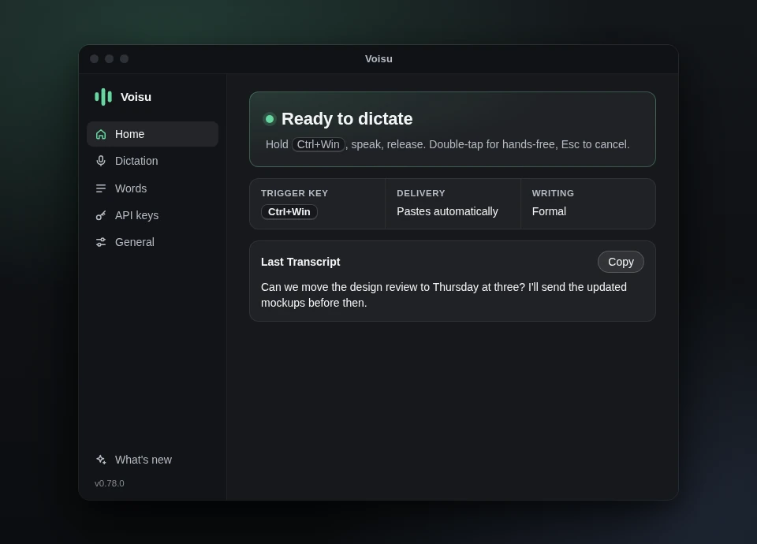

<p align="center">
  
</p>

<h1 align="center">Voisu</h1>

<p align="center">
  Voice dictation for Linux, Windows and macOS, written in Rust.<br />
  Hold a key, speak, and a clean Transcript lands in the app you were typing in.
</p>

<p align="center">
  <a href="https://github.com/Anuraj-dev/voisu/releases/latest/download/Voisu-Setup-x64.exe">Download for Windows</a>
  ·
  <a href="https://github.com/Anuraj-dev/voisu/releases/latest/download/Voisu-macOS-arm64.dmg">Download for macOS</a>
  ·
  <a href="#linux">Install on Linux</a>
  ·
  <a href="https://anuraj-dev.github.io/voisu/">Website</a>
  ·
  <a href="#documentation">Docs</a>
</p>

<p align="center">
  
</p>

Voisu turns speech into text wherever your cursor is: a reply, a doc, or a terminal. If the text can't land there, Voisu keeps it on the clipboard instead of dropping it.

It is a tray app on Windows, a menu bar app on macOS, and a set of systemd user services with a terminal interface on Linux. There is no Voisu account, server or analytics. You bring your own Groq and Deepgram API keys.

## What you get

- **Text where you were typing.** Voisu pastes the Transcript for you. On Windows it goes to the window that had focus when you started, even if you clicked away, and your clipboard is restored afterwards.
- **Two engines, one Transcript.** Deepgram streams while you talk. Groq transcribes the whole Recording when you stop. Voisu reconciles the two.
- **Spoken punctuation and layout.** Say "new paragraph", "dash dash", "quote … unquote" or "first … second …" and it is formatted locally, on every platform.
- **Hold to talk, or go hands-free.** On Windows and macOS, hold the Trigger Key and let go, or double-tap for hands-free. `Esc` cancels. On Linux, press to start and press again to stop.
- **Your words, your tone.** Teach Voisu the names and terms it should spell your way, and choose formal or informal writing.
- **Local transcription on Linux.** Run a model on your own GPU or CPU, offline, after a Consented Install. Nothing downloads until you agree.
- **A command for everything on Linux.** Every setting in the interface is also a plain `voisu` command, so a script or a coding agent can install and check it.
- **Private by default.** Keys live in your desktop keyring, Windows Credential Manager or the macOS Keychain. Logs and history stay on your machine.

## Installation

| Platform | Install |
| --- | --- |
| **Windows** 10 and 11, x64 | [Voisu-Setup-x64.exe](https://github.com/Anuraj-dev/voisu/releases/latest/download/Voisu-Setup-x64.exe) |
| **macOS** 13 or newer, Apple Silicon | [Voisu-macOS-arm64.dmg](https://github.com/Anuraj-dev/voisu/releases/latest/download/Voisu-macOS-arm64.dmg) |
| **Fedora** | `sudo dnf copr enable anuraj-dev/voisu && sudo dnf install voisu` |
| **Arch** | `yay -S voisu-bin` |
| **Debian / Ubuntu** 26.04 LTS, amd64 | [Signed apt repository](docs/linux.md#install) |

### Windows

Run the installer. It installs for your user account, with no admin rights needed. Paste your Groq and Deepgram keys, then hold `Ctrl`+`Win`, speak, and let go.

The installer isn't code-signed yet, so SmartScreen may warn on first run. Choose *More info*, then *Run anyway*. More in the [Windows guide](docs/windows.md).

### macOS

Open the `.dmg` and drag Voisu onto *Applications*. Voisu isn't notarized yet, so macOS blocks the first open: choose *Done*, then *System Settings → Privacy & Security → Open Anyway*. Allow Microphone, Accessibility and Input Monitoring, paste your keys, then hold `Control`+`Option`, speak, and let go.

The [macOS guide](docs/macos.md) covers each step.

### Linux

Voisu ships as systemd **user** services and does not auto-start. Enable it, then open the interface:

```sh
systemctl --user enable --now voisu.service
voisu                 # a fresh install opens on setup
```

Fedora KDE Plasma on Wayland is the primary target. GNOME, Hyprland and X11 desktops work too. The [Linux guide](docs/linux.md) covers the Trigger Key on each desktop, Local transcription, updates and troubleshooting.

The Windows and macOS apps update themselves from GitHub Releases. On Linux, `voisu update` goes through the package manager that installed Voisu.

## Wait, what does it cost?

Nothing. Voisu is free and MIT licensed, with no account and nothing to subscribe to.

Cloud transcription runs on two free API keys, one from Groq and one from Deepgram. Setup checks each key as you save it. On Linux you can skip the cloud and transcribe on your own computer instead.

## Documentation

- [Windows guide](docs/windows.md)
- [macOS guide](docs/macos.md) and the illustrated [Mac setup walkthrough](https://anuraj-dev.github.io/voisu/docs/macos-setup.html)
- [Linux guide](docs/linux.md)
- [Command reference](docs/commands.md)
- [Agent install guide](https://anuraj-dev.github.io/voisu/agent-install.md)
- [Roadmap and known limitations](docs/ROADMAP.md)

## Contributing

Read [CONTRIBUTING.md](CONTRIBUTING.md) before opening an issue or PR. Useful background:

- [Domain language](CONTEXT.md)
- [Architectural decisions](docs/adr/)
- [Linux platform research](docs/research/linux-platform.md)
- [Fedora packaging](docs/packaging-fedora.md)
- Windows and macOS app source: [`apps/windows/`](apps/windows/)

## License

Voisu is licensed under the [MIT License](LICENSE).
